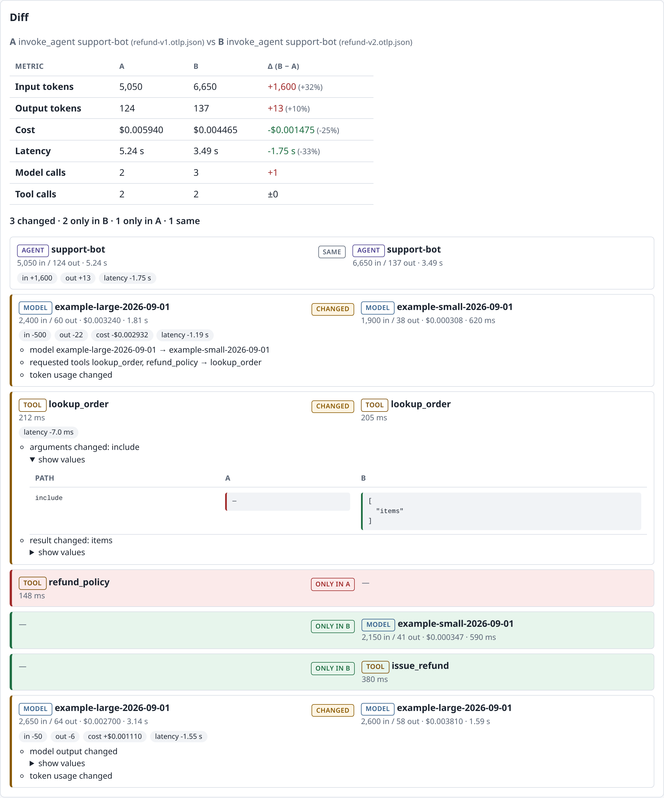
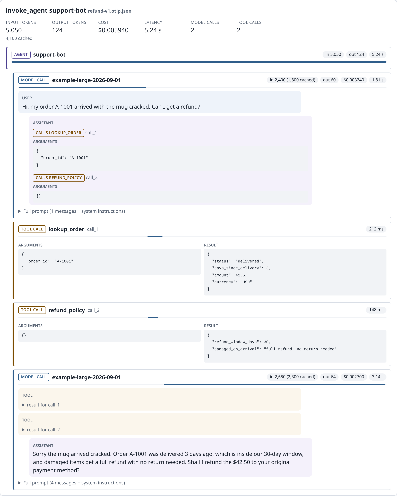

# genai-trace-diff

Read and compare OpenTelemetry GenAI traces in the browser. Drop in an OTLP/JSON trace file and see each agent run as a conversation: messages, tool calls with their arguments and results, and tokens, latency and cost for every step. Pick two runs and see what changed between them, step by step.

It is a static web app. Files are read locally and nothing is uploaded.

**Live app:** https://gratycodes.github.io/genai-trace-diff/ (click "Load sample traces")



## Why

The [OpenTelemetry GenAI semantic conventions](https://opentelemetry.io/docs/specs/semconv/gen-ai/) give agent traces a standard shape: an `invoke_agent` span with `chat` spans for model calls and `execute_tool` spans for tool calls, token counts on each, and (when content capture is on) the prompts, completions, tool arguments and tool results as span attributes. As the OpenTelemetry blog post [Inside the LLM Call: GenAI Observability with OpenTelemetry](https://opentelemetry.io/blog/2026/genai-observability/) puts it, those attributes "can be large, and many observability platforms render them as raw JSON, making them difficult to read."

The second gap is comparison. When you change a prompt, a model or a tool, the question is "what did the agent do differently, and what did it cost?" Answering it usually means reading two JSON blobs side by side. This tool lines the two runs up and tells you.

## Features

- **Load locally.** Drag and drop or pick one or more files. Accepts an OTLP/JSON export request, an array of them, or JSON Lines (the Collector file exporter's format). Hex and base64 span ids both work.
- **Chat-style timeline.** `chat` spans show the new input messages, the assistant output and requested tool calls; the full prompt and system instructions sit behind a disclosure. `execute_tool` spans show arguments and result, or the error. Each step has input/output tokens (with cached tokens), latency, a small waterfall bar and cost.
- **Run totals.** Input, output and cached tokens, cost, wall-clock latency, number of model and tool calls, failed spans. Usage that the agent span repeats from its children is not double counted.
- **Cost from `gen_ai.usage.cost_usd`.** That attribute is not part of the conventions; [otel-genai-cost](https://github.com/gratycodes/otel-genai-cost) adds it in the Collector. Traces without it show "not priced" instead of a made-up number.
- **Side-by-side diff.** Steps are aligned with a longest-common-subsequence over a step key (tool name for tool calls, operation for model calls, so a model swap reads as "changed" rather than "removed + added"). Each row is marked same, changed, only in A or only in B, with:
  - changed tool arguments and results, reported as JSON paths with before/after values,
  - model changes, changed requested tools, changed final output, changed finish reason,
  - new or fixed failures,
  - token, cost and latency deltas, per step and for the whole run.
- **Sample traces** bundled with the app (synthetic, see below).
- Keyboard accessible, labelled controls, status messages announced to screen readers, light and dark themes.



## Run it

Requires Node.js 22.12 or newer.

```sh
npm ci
npm run dev          # http://localhost:5173/genai-trace-diff/
```

Other scripts:

```sh
npm run lint         # ESLint (typescript-eslint, react-hooks)
npm run typecheck    # tsc, strict
npm test             # Vitest unit tests: parsing, GenAI interpretation, alignment, diff
npm run test:e2e     # Playwright, Chromium: load samples, timeline, diff, file picker, bad input
npm run build        # static site in dist/ (set BASE_PATH=/ to host at a domain root)
npm run fixtures     # regenerate the synthetic fixtures
```

### Getting traces into it

Any exporter that writes OTLP/JSON works. Two examples:

- The OpenTelemetry Collector's `file` exporter (JSON Lines) behind your usual OTLP receiver.
- [agent-runtime-kit](https://github.com/gratycodes/agent-runtime-kit)'s `examples/export_otlp_traces.py`, which writes the `agent-runtime-kit.otlp.json` sample in this repo.

To see costs, put the [otel-genai-cost](https://github.com/gratycodes/otel-genai-cost) processor in the Collector pipeline before the exporter.

To see messages and tool arguments, turn on content capture in your instrumentation. It is off by default because prompts and tool data can be sensitive; this app shows token and timing data either way.

## Sample data

Everything in `fixtures/` is synthetic.

- `refund-v1`, `refund-v2`, `refund-v2-timeout` are generated by `scripts/make-fixtures.mjs`: a made-up support agent handling a damaged-item refund. v1 uses one large model and asks before refunding; v2 plans with a small model, passes extra lookup arguments and issues the refund itself; the timeout variant has a failing tool call. Costs use the example price book from otel-genai-cost, and the totals match what its `costreport` CLI prints for the same files ($0.005940, $0.004465, $0.004615).
- `agent-runtime-kit.otlp.json` is real exporter output from agent-runtime-kit's scripted FakeLLM runs. It has tokens but no message content and no cost, which shows how the app handles both.

## Stack

TypeScript (strict), React 19, Vite 8, plain CSS. Vitest 5 for unit tests, Playwright for end-to-end tests, ESLint 10. GitHub Actions runs lint, typecheck, unit tests, Playwright and the build, then deploys `dist/` to GitHub Pages.

The parsing, interpretation and diff code in `src/lib/` has no React or DOM dependency.

```
src/lib/otlp.ts      OTLP/JSON -> flat spans (AnyValue decoding, ids, status, nanosecond times)
src/lib/genai.ts     spans -> traces and steps (GenAI conventions, messages, usage, totals)
src/lib/diff.ts      step alignment (LCS) and per-step / per-run diff
src/components/      timeline, diff view, file loader
```

## Limitations

- Reads OTLP/JSON only. No protobuf files and no live OTLP endpoint; it is a file viewer, not a backend.
- Message parsing follows the current conventions' JSON message schema (`role` + `parts`) plus the older `{role, content}` shape. Older instrumentations that put content in span events with a different shape, or vendor-specific attributes, show up without messages.
- The diff aligns on step order and step key. If a run calls the same tool many times in a different order, the alignment is the longest common subsequence, which may not be the pairing a human would pick. Output text is compared as a whole, not word by word.
- Everything is held in memory; very large files (hundreds of MB) will be slow. Files are not saved between page loads.
- Cost is only as good as the `gen_ai.usage.cost_usd` values in the file. This app does not price anything itself.
- Tested in Chromium. Other modern browsers should work but are not in CI.

## Similar tools

There are good tools for this already, and most do far more:

- **Aspire Dashboard** has a GenAI view that renders `gen_ai.*` content as a conversation (it is the viewer used in the OpenTelemetry blog post above). It runs as a container that receives OTLP live.
- **Langfuse** and **Arize Phoenix** are full LLM observability platforms with tracing, evaluation, datasets and experiment comparison. They need a server (self-hosted or cloud) and their own ingestion.

genai-trace-diff is narrower: a zero-install page for when you already have a trace file and want to read it or compare two runs, without standing up a backend or sending data anywhere.

## License

MIT, see [LICENSE](LICENSE).
